# 驾考通管理后台功能设计

## 目录
1. [功能模块概览](#功能模块概览)
2. [功能拆分与权限设计](#功能拆分与权限设计)
3. [基础模块架构](#基础模块架构)
4. [核心业务模块](#核心业务模块)
5. [多平台配置管理模块](#多平台配置管理模块)
6. [第三方服务集成模块](#第三方服务集成模块)
7. [系统管理模块](#系统管理模块)
8. [枚举类设计](#枚举类设计)
9. [数据字典设计](#数据字典设计)

## 功能模块概览

根据前端页面分析和数据库设计，管理后台应包含以下核心功能模块：

```mermaid
graph TB
    A[管理后台] --> B[用户管理]
    A --> C[题库管理]
    A --> D[考试管理]
    A --> E[学习管理]
    A --> F[积分商城]
    A --> G[内容管理]
    A --> H[多平台配置管理]
    A --> I[第三方服务集成]
    A --> J[系统管理]
    
    B --> B1[用户信息管理]
    B --> B2[用户统计分析]
    B --> B3[VIP管理]
    
    C --> C1[题目管理]
    C --> C2[题型分类管理]
    C --> C3[题目导入导出]
    C --> C4[题目审核]
    
    D --> D1[考试记录查看]
    D --> D2[考试统计分析]
    D --> D3[考试配置管理]
    
    E --> E1[学习记录查看]
    E --> E2[错题本管理]
    E --> E3[收藏管理]
    E --> E4[学习数据统计]
    
    F --> F1[商品管理]
    F --> F2[兑换记录管理]
    F --> F3[积分规则配置]
    
    G --> G1[视频管理]
    G --> G2[交通标志管理]
    G --> G3[评论管理]
    
    H --> H1[登录配置管理]
    H --> H2[支付配置管理]
    H --> H3[应用配置管理]
    
    I --> I1[阿里云视频点播]
    I --> I2[微信接口配置]
    I --> I3[支付宝接口配置]
    I --> I4[华为HMS配置]
    
    J --> J1[系统配置]
    J --> J2[管理员管理]
    J --> J3[操作日志]
    J --> J4[数据备份]
```



## 功能拆分与权限设计

### 角色权限设计

| 角色 | 权限级别 | 主要职责 | 可访问模块 |
|------|----------|----------|------------|
| **超级管理员** | 1 | 系统全局管理 | 所有模块 |
| **内容管理员** | 2 | 题库、视频、标志管理 | 题库管理、内容管理 |
| **运营管理员** | 3 | 用户、商城、统计管理 | 用户管理、积分商城、数据统计 |
| **客服管理员** | 4 | 用户服务、评论管理 | 用户管理（只读）、评论管理 |

### 功能权限矩阵

| 模块 | 超级管理员 | 内容管理员 | 运营管理员 | 客服管理员 |
|------|------------|------------|------------|------------|
| 用户管理 | CRUD | R | CRUD | R |
| 题库管理 | CRUD | CRUD | R | - |
| 考试管理 | CRUD | CR | RU | R |
| 学习管理 | CRUD | R | RU | R |
| 积分商城 | CRUD | - | CRUD | R |
| 内容管理 | CRUD | CRUD | R | RU |
| 系统管理 | CRUD | - | - | - |

## 基础模块架构

### 1. 通用基础模块

```java
// 基础响应封装
public class BaseResponse<T> {
    private Integer code;
    private String message;
    private T data;
    private Long timestamp;
}

// 分页请求基类
public class BasePageRequest {
    private Integer pageNum = 1;
    private Integer pageSize = 10;
    private String orderBy;
    private String orderDirection = "DESC";
}

// 分页响应基类
public class PageResponse<T> {
    private List<T> records;
    private Long total;
    private Integer pageNum;
    private Integer pageSize;
    private Integer totalPages;
}

// 基础实体类
public abstract class BaseEntity {
    private Long id;
    private Integer isDeleted;
    private LocalDateTime gmtCreate;
    private LocalDateTime gmtModified;
}
```

### 2. 异常处理模块

```java
// 业务异常类
public class BusinessException extends RuntimeException {
    private Integer code;
    private String message;
}

// 全局异常处理器
@RestControllerAdvice
public class GlobalExceptionHandler {
    
    @ExceptionHandler(BusinessException.class)
    public BaseResponse<Void> handleBusinessException(BusinessException e) {
        return BaseResponse.error(e.getCode(), e.getMessage());
    }
    
    @ExceptionHandler(MethodArgumentNotValidException.class)
    public BaseResponse<Void> handleValidationException(MethodArgumentNotValidException e) {
        // 参数校验异常处理
    }
}
```

### 3. 数据访问层封装

```java
// 基础Mapper接口
public interface BaseMapper<T> {
    int insert(T entity);
    int updateById(T entity);
    int deleteById(Long id);
    T selectById(Long id);
    List<T> selectList(QueryWrapper<T> wrapper);
    IPage<T> selectPage(IPage<T> page, QueryWrapper<T> wrapper);
}

// 基础Service接口
public interface BaseService<T> {
    boolean save(T entity);
    boolean updateById(T entity);
    boolean removeById(Long id);
    T getById(Long id);
    PageResponse<T> page(BasePageRequest request);
}
```

## 多平台配置管理模块

### 1. 登录配置管理

根据前端代码分析，应用支持多种登录方式，需要在管理后台进行动态配置：

#### 1.1 微信小程序登录配置

```java
@RestController
@RequestMapping("/admin/config/login/wechat-mini")
public class WechatMiniLoginConfigController {
    
    // 微信小程序配置查看
    @GetMapping("/config")
    public BaseResponse<WechatMiniConfigVO> getWechatMiniConfig() {
        return BaseResponse.success(loginConfigService.getWechatMiniConfig());
    }
    
    // 微信小程序配置更新
    @PutMapping("/config")
    public BaseResponse<Void> updateWechatMiniConfig(@Valid @RequestBody WechatMiniConfigRequest request) {
        loginConfigService.updateWechatMiniConfig(request);
        return BaseResponse.success();
    }
    
    // 配置测试
    @PostMapping("/test")
    public BaseResponse<Void> testWechatMiniConfig(@RequestBody WechatMiniTestRequest request) {
        return BaseResponse.success(loginConfigService.testWechatMiniConfig(request));
    }
}

// 微信小程序配置实体
public class WechatMiniConfigVO {
    private String appId;           // 小程序AppID
    private String appSecret;       // 小程序AppSecret
    private String mchId;           // 商户号(支付用)
    private String apiKey;          // API密钥
    private Boolean enableLogin;    // 是否启用登录
    private Boolean enablePayment;  // 是否启用支付
    private String environment;     // 环境(sandbox/production)
    private LocalDateTime updateTime;
}
```

#### 1.2 APP端登录配置

```java
// 华为账号登录配置
@RestController
@RequestMapping("/admin/config/login/huawei")
public class HuaweiLoginConfigController {
    
    @GetMapping("/config")
    public BaseResponse<HuaweiConfigVO> getHuaweiConfig() {
        return BaseResponse.success(loginConfigService.getHuaweiConfig());
    }
    
    @PutMapping("/config")
    public BaseResponse<Void> updateHuaweiConfig(@Valid @RequestBody HuaweiConfigRequest request) {
        loginConfigService.updateHuaweiConfig(request);
        return BaseResponse.success();
    }
}

// 微信APP登录配置
@RestController
@RequestMapping("/admin/config/login/wechat-app")
public class WechatAppLoginConfigController {
    
    @GetMapping("/config")
    public BaseResponse<WechatAppConfigVO> getWechatAppConfig() {
        return BaseResponse.success(loginConfigService.getWechatAppConfig());
    }
    
    @PutMapping("/config")
    public BaseResponse<Void> updateWechatAppConfig(@Valid @RequestBody WechatAppConfigRequest request) {
        loginConfigService.updateWechatAppConfig(request);
        return BaseResponse.success();
    }
}
```

#### 1.3 短信验证码登录配置

```java
@RestController
@RequestMapping("/admin/config/login/sms")
public class SmsLoginConfigController {
    
    // SMS服务配置
    @GetMapping("/config")
    public BaseResponse<SmsConfigVO> getSmsConfig() {
        return BaseResponse.success(loginConfigService.getSmsConfig());
    }
    
    @PutMapping("/config")
    public BaseResponse<Void> updateSmsConfig(@Valid @RequestBody SmsConfigRequest request) {
        loginConfigService.updateSmsConfig(request);
        return BaseResponse.success();
    }
    
    // 短信模板管理
    @GetMapping("/templates")
    public BaseResponse<List<SmsTemplateVO>> getSmsTemplates() {
        return BaseResponse.success(loginConfigService.getSmsTemplates());
    }
}

public class SmsConfigVO {
    private String provider;        // 服务商(aliyun/tencent/huawei)
    private String accessKeyId;     // 访问密钥ID
    private String accessKeySecret; // 访问密钥Secret
    private String signName;        // 短信签名
    private String templateCode;    // 模板代码
    private Integer codeLength;     // 验证码长度
    private Integer expireMinutes;  // 过期时间(分钟)
    private Integer dailyLimit;     // 单日限制
    private Boolean enabled;        // 是否启用
}
```

### 2. 支付配置管理

根据前端支付页面分析，需要支持多种支付方式的动态配置：

#### 2.1 微信支付配置

```java
@RestController
@RequestMapping("/admin/config/payment/wechat")
public class WechatPaymentConfigController {
    
    // 微信支付配置查看
    @GetMapping("/config")
    public BaseResponse<WechatPayConfigVO> getWechatPayConfig() {
        return BaseResponse.success(paymentConfigService.getWechatPayConfig());
    }
    
    // 微信支付配置更新
    @PutMapping("/config")
    public BaseResponse<Void> updateWechatPayConfig(@Valid @RequestBody WechatPayConfigRequest request) {
        paymentConfigService.updateWechatPayConfig(request);
        return BaseResponse.success();
    }
    
    // 支付测试
    @PostMapping("/test")
    public BaseResponse<PaymentTestResultVO> testWechatPayment(@RequestBody PaymentTestRequest request) {
        return BaseResponse.success(paymentConfigService.testWechatPayment(request));
    }
    
    // 商户号验证
    @PostMapping("/verify-merchant")
    public BaseResponse<MerchantVerifyResultVO> verifyMerchant(@RequestBody MerchantVerifyRequest request) {
        return BaseResponse.success(paymentConfigService.verifyWechatMerchant(request));
    }
}

public class WechatPayConfigVO {
    private String appId;           // 应用ID
    private String mchId;           // 商户号
    private String apiKey;          // API密钥
    private String certSerialNo;    // 证书序列号
    private String privateKeyPath;  // 私钥文件路径
    private String certPath;        // 证书文件路径
    private String notifyUrl;       // 回调地址
    private String environment;     // 环境(sandbox/production)
    private Boolean enableMiniPay;  // 启用小程序支付
    private Boolean enableAppPay;   // 启用APP支付
    private Boolean enableH5Pay;    // 启用H5支付
    private LocalDateTime updateTime;
}
```

#### 2.2 支付宝配置

```java
@RestController
@RequestMapping("/admin/config/payment/alipay")
public class AlipayConfigController {
    
    @GetMapping("/config")
    public BaseResponse<AlipayConfigVO> getAlipayConfig() {
        return BaseResponse.success(paymentConfigService.getAlipayConfig());
    }
    
    @PutMapping("/config")
    public BaseResponse<Void> updateAlipayConfig(@Valid @RequestBody AlipayConfigRequest request) {
        paymentConfigService.updateAlipayConfig(request);
        return BaseResponse.success();
    }
    
    @PostMapping("/test")
    public BaseResponse<PaymentTestResultVO> testAlipayment(@RequestBody PaymentTestRequest request) {
        return BaseResponse.success(paymentConfigService.testAlipayment(request));
    }
}

public class AlipayConfigVO {
    private String appId;           // 应用ID
    private String privateKey;      // 应用私钥
    private String publicKey;       // 支付宝公钥
    private String gatewayUrl;      // 网关地址
    private String notifyUrl;       // 回调地址
    private String returnUrl;       // 返回地址
    private String signType;        // 签名类型
    private String charset;         // 字符集
    private String format;          // 数据格式
    private String environment;     // 环境
    private Boolean enableAppPay;   // 启用APP支付
    private Boolean enableWebPay;   // 启用网页支付
    private LocalDateTime updateTime;
}
```

### 3. 应用配置管理

#### 3.1 多端应用配置

```java
@RestController
@RequestMapping("/admin/config/application")
public class ApplicationConfigController {
    
    // 应用配置列表
    @GetMapping("/platforms")
    public BaseResponse<List<PlatformConfigVO>> getPlatformConfigs() {
        return BaseResponse.success(appConfigService.getPlatformConfigs());
    }
    
    // 更新平台配置
    @PutMapping("/platforms/{platform}")
    public BaseResponse<Void> updatePlatformConfig(@PathVariable String platform, 
                                                  @RequestBody PlatformConfigRequest request) {
        appConfigService.updatePlatformConfig(platform, request);
        return BaseResponse.success();
    }
    
    // 应用版本管理
    @GetMapping("/versions")
    public BaseResponse<List<AppVersionVO>> getAppVersions() {
        return BaseResponse.success(appConfigService.getAppVersions());
    }
    
    @PostMapping("/versions")
    public BaseResponse<Void> addAppVersion(@RequestBody AppVersionRequest request) {
        appConfigService.addAppVersion(request);
        return BaseResponse.success();
    }
}

public class PlatformConfigVO {
    private String platform;        // 平台(mp-weixin/app-plus/h5)
    private String appName;          // 应用名称
    private String appId;            // 应用ID
    private String packageName;      // 包名
    private String version;          // 版本号
    private Integer versionCode;     // 版本代码
    private Boolean enabled;         // 是否启用
    private String downloadUrl;      // 下载地址
    private String updateLog;        // 更新日志
    private Boolean forceUpdate;     // 是否强制更新
    private LocalDateTime updateTime;
}
```

#### 功能清单
- **用户信息管理**：查看、编辑、禁用用户
- **用户统计分析**：注册量、活跃度、学习数据统计
- **VIP管理**：VIP用户管理、到期提醒
- **用户行为分析**：学习路径、答题习惯分析

#### 核心接口设计

```java
@RestController
@RequestMapping("/admin/users")
public class UserController {
    
    // 用户列表查询
    @GetMapping("/list")
    public BaseResponse<PageResponse<UserVO>> getUserList(UserQueryRequest request) {
        return BaseResponse.success(userService.getUserPage(request));
    }
    
    // 用户详情
    @GetMapping("/{userId}")
    public BaseResponse<UserDetailVO> getUserDetail(@PathVariable Long userId) {
        return BaseResponse.success(userService.getUserDetail(userId));
    }
    
    // 用户状态更新
    @PutMapping("/{userId}/status")
    public BaseResponse<Void> updateUserStatus(@PathVariable Long userId, 
                                             @RequestBody UserStatusUpdateRequest request) {
        userService.updateUserStatus(userId, request);
        return BaseResponse.success();
    }
    
    // 用户学习统计
    @GetMapping("/{userId}/statistics")
    public BaseResponse<UserStudyStatisticsVO> getUserStatistics(@PathVariable Long userId) {
        return BaseResponse.success(userService.getUserStatistics(userId));
    }
}
```

### 2. 题库管理模块

#### 功能清单
- **题目管理**：新增、编辑、删除、批量操作
- **题型分类管理**：题型维护、难度设置
- **题目导入导出**：Excel批量导入、模板下载
- **题目审核**：题目审核流程、质量控制
- **题目统计**：正确率、难度分析

#### 核心接口设计

```java
@RestController
@RequestMapping("/admin/questions")
public class QuestionController {
    
    // 题目列表
    @GetMapping("/list")
    public BaseResponse<PageResponse<QuestionVO>> getQuestionList(QuestionQueryRequest request) {
        return BaseResponse.success(questionService.getQuestionPage(request));
    }
    
    // 新增题目
    @PostMapping
    public BaseResponse<Void> createQuestion(@Valid @RequestBody QuestionCreateRequest request) {
        questionService.createQuestion(request);
        return BaseResponse.success();
    }
    
    // 批量导入
    @PostMapping("/import")
    public BaseResponse<QuestionImportResultVO> importQuestions(@RequestParam("file") MultipartFile file) {
        return BaseResponse.success(questionService.importQuestions(file));
    }
    
    // 题目统计
    @GetMapping("/statistics")
    public BaseResponse<QuestionStatisticsVO> getQuestionStatistics(QuestionStatisticsRequest request) {
        return BaseResponse.success(questionService.getQuestionStatistics(request));
    }
}
```

### 3. 考试管理模块

#### 功能清单
- **考试记录查看**：考试记录列表、详情查看
- **考试统计分析**：通过率、平均分、时间分布
- **考试配置管理**：考试时长、题目数量、及格分数
- **异常考试处理**：异常考试记录处理

## 核心业务模块

### 1. 用户管理模块

#### 功能清单
- **用户信息管理**：查看、编辑、禁用用户
- **用户统计分析**：注册量、活跃度、学习数据统计
- **VIP管理**：VIP用户管理、到期提醒
- **用户行为分析**：学习路径、答题习惯分析

#### 核心接口设计

```java
@RestController
@RequestMapping("/admin/users")
public class UserController {
    
    // 用户列表查询
    @GetMapping("/list")
    public BaseResponse<PageResponse<UserVO>> getUserList(UserQueryRequest request) {
        return BaseResponse.success(userService.getUserPage(request));
    }
    
    // 用户详情
    @GetMapping("/{userId}")
    public BaseResponse<UserDetailVO> getUserDetail(@PathVariable Long userId) {
        return BaseResponse.success(userService.getUserDetail(userId));
    }
    
    // 用户状态更新
    @PutMapping("/{userId}/status")
    public BaseResponse<Void> updateUserStatus(@PathVariable Long userId, 
                                             @RequestBody UserStatusUpdateRequest request) {
        userService.updateUserStatus(userId, request);
        return BaseResponse.success();
    }
    
    // 用户学习统计
    @GetMapping("/{userId}/statistics")
    public BaseResponse<UserStudyStatisticsVO> getUserStatistics(@PathVariable Long userId) {
        return BaseResponse.success(userService.getUserStatistics(userId));
    }
}
```

### 2. 题库管理模块

#### 功能清单
- **题目管理**：新增、编辑、删除、批量操作
- **题型分类管理**：题型维护、难度设置
- **题目导入导出**：Excel批量导入、模板下载
- **题目审核**：题目审核流程、质量控制
- **题目统计**：正确率、难度分析

#### 核心接口设计

```java
@RestController
@RequestMapping("/admin/questions")
public class QuestionController {
    
    // 题目列表
    @GetMapping("/list")
    public BaseResponse<PageResponse<QuestionVO>> getQuestionList(QuestionQueryRequest request) {
        return BaseResponse.success(questionService.getQuestionPage(request));
    }
    
    // 新增题目
    @PostMapping
    public BaseResponse<Void> createQuestion(@Valid @RequestBody QuestionCreateRequest request) {
        questionService.createQuestion(request);
        return BaseResponse.success();
    }
    
    // 批量导入
    @PostMapping("/import")
    public BaseResponse<QuestionImportResultVO> importQuestions(@RequestParam("file") MultipartFile file) {
        return BaseResponse.success(questionService.importQuestions(file));
    }
    
    // 题目统计
    @GetMapping("/statistics")
    public BaseResponse<QuestionStatisticsVO> getQuestionStatistics(QuestionStatisticsRequest request) {
        return BaseResponse.success(questionService.getQuestionStatistics(request));
    }
}
```

### 3. 考试管理模块

#### 功能清单
- **考试记录查看**：考试记录列表、详情查看
- **考试统计分析**：通过率、平均分、时间分布
- **考试配置管理**：考试时长、题目数量、及格分数
- **异常考试处理**：异常考试记录处理

### 4. 学习管理模块

#### 功能清单
- **学习记录查看**：用户学习轨迹、学习时长统计
- **错题本管理**：错题分析、推荐复习
- **收藏管理**：用户收藏题目统计
- **学习数据统计**：学习效果分析、知识点掌握度

### 5. 积分商城模块

#### 功能清单
- **商品管理**：商品增删改查、库存管理
- **兑换记录管理**：兑换订单处理、发货管理
- **积分规则配置**：积分获取规则、消费规则

### 6. 内容管理模块

#### 功能清单
- **视频管理**：视频上传、编辑、分类管理
- **交通标志管理**：标志图片、说明文字管理
- **评论管理**：评论审核、违规处理

### 1. 阿里云视频点播服务配置

根据前端视频功能分析，需要在管理后台动态配置阿里云视频点播服务：

#### 1.1 视频点播配置管理

```java
@RestController
@RequestMapping("/admin/config/aliyun/vod")
public class AliyunVodConfigController {
    
    // 获取视频点播配置
    @GetMapping("/config")
    public BaseResponse<AliyunVodConfigVO> getVodConfig() {
        return BaseResponse.success(vodConfigService.getVodConfig());
    }
    
    // 更新视频点播配置
    @PutMapping("/config")
    public BaseResponse<Void> updateVodConfig(@Valid @RequestBody AliyunVodConfigRequest request) {
        vodConfigService.updateVodConfig(request);
        return BaseResponse.success();
    }
    
    // 测试连接
    @PostMapping("/test")
    public BaseResponse<VodTestResultVO> testVodConnection(@RequestBody VodTestRequest request) {
        return BaseResponse.success(vodConfigService.testVodConnection(request));
    }
    
    // 获取上传凭证
    @PostMapping("/upload-token")
    public BaseResponse<VodUploadTokenVO> getUploadToken(@RequestBody VodUploadTokenRequest request) {
        return BaseResponse.success(vodConfigService.getUploadToken(request));
    }
    
    // 视频转码配置
    @GetMapping("/transcode-templates")
    public BaseResponse<List<TranscodeTemplateVO>> getTranscodeTemplates() {
        return BaseResponse.success(vodConfigService.getTranscodeTemplates());
    }
    
    @PostMapping("/transcode-templates")
    public BaseResponse<Void> addTranscodeTemplate(@RequestBody TranscodeTemplateRequest request) {
        vodConfigService.addTranscodeTemplate(request);
        return BaseResponse.success();
    }
}

public class AliyunVodConfigVO {
    private String accessKeyId;       // 访问密钥ID
    private String accessKeySecret;   // 访问密钥Secret
    private String regionId;          // 地域 ID
    private String endpoint;          // 服务端点
    private String storageLocation;   // 存储地址
    private String cateId;            // 分类 ID
    private String templateGroupId;   // 转码模板组 ID
    private String workflowId;        // 工作流 ID
    private String coverUrl;          // 默认封面地址
    private String playDomain;        // 播放域名
    private String cdnDomain;         // CDN 域名
    private Integer storageTime;      // 存储时间(天)
    private Boolean enableSts;        // 是否启用 STS
    private Boolean enableHttps;      // 是否启用 HTTPS
    private Boolean enableWatermark;  // 是否启用水印
    private String watermarkId;       // 水印 ID
    private Boolean enabled;          // 是否启用
    private LocalDateTime updateTime;
}
```

#### 1.2 视频管理功能

```java
@RestController
@RequestMapping("/admin/videos")
public class VideoManagementController {
    
    // 视频列表
    @GetMapping("/list")
    public BaseResponse<PageResponse<VideoVO>> getVideoList(VideoQueryRequest request) {
        return BaseResponse.success(videoService.getVideoPage(request));
    }
    
    // 上传视频
    @PostMapping("/upload")
    public BaseResponse<VideoUploadResultVO> uploadVideo(@RequestParam("file") MultipartFile file,
                                                       @RequestParam("title") String title,
                                                       @RequestParam("category") String category) {
        return BaseResponse.success(videoService.uploadVideo(file, title, category));
    }
    
    // 更新视频信息
    @PutMapping("/{videoId}")
    public BaseResponse<Void> updateVideo(@PathVariable String videoId,
                                        @RequestBody VideoUpdateRequest request) {
        videoService.updateVideo(videoId, request);
        return BaseResponse.success();
    }
    
    // 删除视频
    @DeleteMapping("/{videoId}")
    public BaseResponse<Void> deleteVideo(@PathVariable String videoId) {
        videoService.deleteVideo(videoId);
        return BaseResponse.success();
    }
    
    // 获取播放凭证
    @PostMapping("/{videoId}/play-auth")
    public BaseResponse<VideoPlayAuthVO> getPlayAuth(@PathVariable String videoId) {
        return BaseResponse.success(videoService.getPlayAuth(videoId));
    }
    
    // 视频统计数据
    @GetMapping("/statistics")
    public BaseResponse<VideoStatisticsVO> getVideoStatistics(VideoStatisticsRequest request) {
        return BaseResponse.success(videoService.getVideoStatistics(request));
    }
}

public class VideoVO {
    private String videoId;           // 视频 ID
    private String title;             // 标题
    private String description;       // 描述
    private String category;          // 分类
    private String coverUrl;          // 封面地址
    private String playUrl;           // 播放地址
    private Integer duration;         // 时长(秒)
    private Long size;                // 文件大小(字节)
    private String status;            // 状态
    private String resolution;        // 分辨率
    private String format;            // 格式
    private Integer viewCount;        // 播放次数
    private Integer likeCount;        // 点赞数
    private Boolean isVip;            // 是否VIP视频
    private Boolean isPublished;      // 是否发布
    private LocalDateTime uploadTime; // 上传时间
    private LocalDateTime publishTime; // 发布时间
}
```

### 2. 微信接口配置

#### 2.1 微信公众号/小程序配置

```java
@RestController
@RequestMapping("/admin/config/wechat")
public class WechatConfigController {
    
    // 微信基础配置
    @GetMapping("/basic")
    public BaseResponse<WechatBasicConfigVO> getWechatBasicConfig() {
        return BaseResponse.success(wechatConfigService.getBasicConfig());
    }
    
    @PutMapping("/basic")
    public BaseResponse<Void> updateWechatBasicConfig(@RequestBody WechatBasicConfigRequest request) {
        wechatConfigService.updateBasicConfig(request);
        return BaseResponse.success();
    }
    
    // 微信菜单配置
    @GetMapping("/menu")
    public BaseResponse<WechatMenuVO> getWechatMenu() {
        return BaseResponse.success(wechatConfigService.getMenu());
    }
    
    @PutMapping("/menu")
    public BaseResponse<Void> updateWechatMenu(@RequestBody WechatMenuRequest request) {
        wechatConfigService.updateMenu(request);
        return BaseResponse.success();
    }
    
    // 微信自动回复配置
    @GetMapping("/auto-reply")
    public BaseResponse<List<WechatAutoReplyVO>> getAutoReplyList() {
        return BaseResponse.success(wechatConfigService.getAutoReplyList());
    }
    
    @PostMapping("/auto-reply")
    public BaseResponse<Void> addAutoReply(@RequestBody WechatAutoReplyRequest request) {
        wechatConfigService.addAutoReply(request);
        return BaseResponse.success();
    }
}

public class WechatBasicConfigVO {
    private String appId;             // 应用 ID
    private String appSecret;         // 应用密钥
    private String token;             // 令牌
    private String encodingAesKey;    // 消息加密密钥
    private String serverUrl;         // 服务器地址
    private Boolean enableEncrypt;    // 是否启用加密
    private Boolean enableAutoReply;  // 是否启用自动回复
    private String welcomeMessage;    // 欢迎词
    private LocalDateTime updateTime;
}
```

### 3. 支付宝接口配置

#### 3.1 支付宝开放平台配置

```java
@RestController
@RequestMapping("/admin/config/alipay-open")
public class AlipayOpenConfigController {
    
    // 支付宝开放平台配置
    @GetMapping("/config")
    public BaseResponse<AlipayOpenConfigVO> getAlipayOpenConfig() {
        return BaseResponse.success(alipayConfigService.getOpenConfig());
    }
    
    @PutMapping("/config")
    public BaseResponse<Void> updateAlipayOpenConfig(@RequestBody AlipayOpenConfigRequest request) {
        alipayConfigService.updateOpenConfig(request);
        return BaseResponse.success();
    }
    
    // 小程序配置
    @GetMapping("/mini-program")
    public BaseResponse<AlipayMiniConfigVO> getAlipayMiniConfig() {
        return BaseResponse.success(alipayConfigService.getMiniConfig());
    }
    
    @PutMapping("/mini-program")
    public BaseResponse<Void> updateAlipayMiniConfig(@RequestBody AlipayMiniConfigRequest request) {
        alipayConfigService.updateMiniConfig(request);
        return BaseResponse.success();
    }
}

public class AlipayOpenConfigVO {
    private String appId;             // 应用 ID
    private String privateKey;        // 应用私钥
    private String publicKey;         // 支付宝公钥
    private String gatewayUrl;        // 网关地址
    private String authCallbackUrl;   // 授权回调地址
    private String scope;             // 授权范围
    private Boolean enableAuth;       // 是否启用授权登录
    private Boolean enablePay;        // 是否启用支付
    private LocalDateTime updateTime;
}
```

### 4. 华为HMS配置

#### 4.1 华为移动服务配置

```java
@RestController
@RequestMapping("/admin/config/huawei/hms")
public class HuaweiHmsConfigController {
    
    // HMS Core 配置
    @GetMapping("/core")
    public BaseResponse<HuaweiHmsCoreConfigVO> getHmsCoreConfig() {
        return BaseResponse.success(huaweiConfigService.getHmsCoreConfig());
    }
    
    @PutMapping("/core")
    public BaseResponse<Void> updateHmsCoreConfig(@RequestBody HuaweiHmsCoreConfigRequest request) {
        huaweiConfigService.updateHmsCoreConfig(request);
        return BaseResponse.success();
    }
    
    // 华为账号服务配置
    @GetMapping("/account")
    public BaseResponse<HuaweiAccountConfigVO> getAccountConfig() {
        return BaseResponse.success(huaweiConfigService.getAccountConfig());
    }
    
    @PutMapping("/account")
    public BaseResponse<Void> updateAccountConfig(@RequestBody HuaweiAccountConfigRequest request) {
        huaweiConfigService.updateAccountConfig(request);
        return BaseResponse.success();
    }
    
    // 华为应用内支付配置
    @GetMapping("/iap")
    public BaseResponse<HuaweiIapConfigVO> getIapConfig() {
        return BaseResponse.success(huaweiConfigService.getIapConfig());
    }
    
    @PutMapping("/iap")
    public BaseResponse<Void> updateIapConfig(@RequestBody HuaweiIapConfigRequest request) {
        huaweiConfigService.updateIapConfig(request);
        return BaseResponse.success();
    }
}

public class HuaweiHmsCoreConfigVO {
    private String appId;             // 应用 ID
    private String clientId;          // 客户端 ID
    private String clientSecret;      // 客户端密钥
    private String serverClientId;    // 服务端客户端 ID
    private String apiKey;            // API 密钥
    private String packageName;       // 包名
    private String signSha256;        // 签名 SHA256
    private Boolean enableAccount;    // 启用账号服务
    private Boolean enableIap;        // 启用应用内支付
    private Boolean enablePush;       // 启用推送服务
    private Boolean enableAnalytics;  // 启用分析服务
    private LocalDateTime updateTime;
}
```

### 5. 第三方服务状态监控

```java
@RestController
@RequestMapping("/admin/third-party/monitor")
public class ThirdPartyMonitorController {
    
    // 服务状态检查
    @GetMapping("/status")
    public BaseResponse<List<ServiceStatusVO>> getServiceStatus() {
        return BaseResponse.success(monitorService.getServiceStatus());
    }
    
    // 服务可用性统计
    @GetMapping("/availability")
    public BaseResponse<List<ServiceAvailabilityVO>> getServiceAvailability(AvailabilityQueryRequest request) {
        return BaseResponse.success(monitorService.getServiceAvailability(request));
    }
    
    // 服务调用统计
    @GetMapping("/api-statistics")
    public BaseResponse<ApiStatisticsVO> getApiStatistics(ApiStatisticsRequest request) {
        return BaseResponse.success(monitorService.getApiStatistics(request));
    }
}

public class ServiceStatusVO {
    private String serviceName;       // 服务名称
    private String status;            // 状态(online/offline/error)
    private String lastCheckTime;     // 最后检查时间
    private Integer responseTime;     // 响应时间(ms)
    private String errorMessage;      // 错误信息
    private Double successRate;       // 成功率
}
```

#### 功能清单
- **学习记录查看**：用户学习轨迹、学习时长统计
- **错题本管理**：错题分析、推荐复习
- **收藏管理**：用户收藏题目统计
- **学习数据统计**：学习效果分析、知识点掌握度

### 5. 积分商城模块

#### 功能清单
- **商品管理**：商品增删改查、库存管理
- **兑换记录管理**：兑换订单处理、发货管理
- **积分规则配置**：积分获取规则、消费规则

### 6. 内容管理模块

#### 功能清单
- **视频管理**：视频上传、编辑、分类管理
- **交通标志管理**：标志图片、说明文字管理
- **评论管理**：评论审核、违规处理

## 系统管理模块

### 1. 系统配置管理

```java
@RestController
@RequestMapping("/admin/system/config")
public class SystemConfigController {
    
    // 配置列表
    @GetMapping("/list")
    public BaseResponse<List<SystemConfigVO>> getConfigList() {
        return BaseResponse.success(systemConfigService.getConfigList());
    }
    
    // 更新配置
    @PutMapping("/{configKey}")
    public BaseResponse<Void> updateConfig(@PathVariable String configKey, 
                                         @RequestBody SystemConfigUpdateRequest request) {
        systemConfigService.updateConfig(configKey, request);
        return BaseResponse.success();
    }
}
```

### 2. 管理员管理

```java
@RestController
@RequestMapping("/admin/administrators")
public class AdministratorController {
    
    // 管理员列表
    @GetMapping("/list")
    public BaseResponse<PageResponse<AdministratorVO>> getAdministratorList(AdministratorQueryRequest request) {
        return BaseResponse.success(administratorService.getAdministratorPage(request));
    }
    
    // 新增管理员
    @PostMapping
    public BaseResponse<Void> createAdministrator(@Valid @RequestBody AdministratorCreateRequest request) {
        administratorService.createAdministrator(request);
        return BaseResponse.success();
    }
    
    // 权限管理
    @PutMapping("/{adminId}/permissions")
    public BaseResponse<Void> updatePermissions(@PathVariable Long adminId, 
                                              @RequestBody AdminPermissionUpdateRequest request) {
        administratorService.updatePermissions(adminId, request);
        return BaseResponse.success();
    }
}
```

### 3. 操作日志管理

```java
// 操作日志记录注解
@Target(ElementType.METHOD)
@Retention(RetentionPolicy.RUNTIME)
public @interface OperationLog {
    String operation();
    String module();
}

// 日志切面
@Aspect
@Component
public class OperationLogAspect {
    
    @Around("@annotation(operationLog)")
    public Object logOperation(ProceedingJoinPoint joinPoint, OperationLog operationLog) {
        // 记录操作日志逻辑
    }
}
```

## 枚举类设计

### 1. 多平台相关枚举

```java
// 平台类型枚举
public enum PlatformEnum {
    MP_WEIXIN("mp-weixin", "微信小程序"),
    APP_PLUS("app-plus", "APP端"),
    H5("h5", "H5网页端"),
    MP_ALIPAY("mp-alipay", "支付宝小程序"),
    MP_TOUTIAO("mp-toutiao", "字节小程序"),
    MP_BAIDU("mp-baidu", "百度小程序");
    
    private final String code;
    private final String desc;
}

// 登录方式枚举
public enum LoginTypeEnum {
    WECHAT_MINI("wechat_mini", "微信小程序登录"),
    WECHAT_APP("wechat_app", "微信APP登录"),
    ALIPAY("alipay", "支付宝登录"),
    HUAWEI("huawei", "华为账号登录"),
    MOBILE("mobile", "手机号登录"),
    SMS_CODE("sms_code", "短信验证码登录"),
    GUEST("guest", "游客登录");
    
    private final String code;
    private final String desc;
}

// 支付方式枚举
public enum PaymentTypeEnum {
    WECHAT_PAY("wechat_pay", "微信支付"),
    ALIPAY("alipay", "支付宝"),
    UNIONPAY("unionpay", "银联支付"),
    APPLE_PAY("apple_pay", "Apple Pay"),
    HUAWEI_PAY("huawei_pay", "华为Pay");
    
    private final String code;
    private final String desc;
}

// 支付环境枚举
public enum PaymentEnvironmentEnum {
    SANDBOX("sandbox", "沙箱环境"),
    PRODUCTION("production", "生产环境");
    
    private final String code;
    private final String desc;
}
```

### 2. 用户相关枚举

```java
// 用户状态枚举
public enum UserStatusEnum {
    NORMAL(1, "正常"),
    DISABLED(0, "禁用"),
    LOCKED(2, "锁定");
    
    private final Integer code;
    private final String desc;
}

// VIP等级枚举
public enum VipLevelEnum {
    NORMAL(0, "普通用户"),
    VIP_MONTHLY(1, "VIP月会员"),
    VIP_YEARLY(2, "VIP年会员"),
    VIP_LIFETIME(3, "VIP终身会员");
    
    private final Integer code;
    private final String desc;
}

// 性别枚举
public enum GenderEnum {
    UNKNOWN(0, "未知"),
    MALE(1, "男"),
    FEMALE(2, "女");
    
    private final Integer code;
    private final String desc;
}
```

### 3. 题目相关枚举

```java
// 科目枚举
public enum SubjectEnum {
    SUBJECT_ONE(1, "科目一"),
    SUBJECT_FOUR(4, "科目四");
    
    private final Integer code;
    private final String desc;
}

// 难度等级枚举
public enum DifficultyEnum {
    EASY(1, "简单"),
    MEDIUM(2, "中等"),
    HARD(3, "困难");
    
    private final Integer code;
    private final String desc;
}

// 题型枚举
public enum QuestionTypeEnum {
    TRAFFIC_SIGNS("traffic_signs", "交通标志"),
    TRAFFIC_RULES("traffic_rules", "交通法规"),
    DRIVING_SKILLS("driving_skills", "驾驶技能"),
    SAFE_DRIVING("safe_driving", "安全驾驶"),
    EMERGENCY_HANDLING("emergency_handling", "紧急处理"),
    VEHICLE_MAINTENANCE("vehicle_maintenance", "车辆维护");
    
    private final String code;
    private final String desc;
}

// 答案选项枚举
public enum AnswerEnum {
    A(1, "A"),
    B(2, "B"), 
    C(3, "C"),
    D(4, "D"),
    TRUE(1, "正确"),
    FALSE(2, "错误");
    
    private final Integer code;
    private final String desc;
}
```

### 4. 视频相关枚举

```java
// 视频状态枚举
public enum VideoStatusEnum {
    UPLOADING("uploading", "上传中"),
    TRANSCODING("transcoding", "转码中"),
    NORMAL("normal", "正常"),
    BLOCKED("blocked", "封禁"),
    DELETED("deleted", "已删除");
    
    private final String code;
    private final String desc;
}

// 视频分类枚举
public enum VideoCategoryEnum {
    TRAFFIC_SIGNS("traffic-signs", "交通标志"),
    TRAFFIC_RULES("traffic-rules", "交通法规"),
    DRIVING_SKILLS("driving-skills", "驾驶技巧"),
    SAFE_DRIVING("safe-driving", "安全驾驶"),
    EXAM_TIPS("exam-tips", "考试技巧");
    
    private final String code;
    private final String desc;
}

// 视频质量枚举
public enum VideoQualityEnum {
    STANDARD("SD", "标清", "480p"),
    HIGH("HD", "高清", "720p"),
    ULTRA("FHD", "超清", "1080p"),
    FOUR_K("4K", "4K超清", "2160p");
    
    private final String code;
    private final String desc;
    private final String resolution;
}
```

### 5. 考试相关枚举

```java
// 考试状态枚举
public enum ExamStatusEnum {
    IN_PROGRESS(0, "进行中"),
    COMPLETED(1, "已完成"),
    ABANDONED(2, "已放弃"),
    TIMEOUT(3, "超时");
    
    private final Integer code;
    private final String desc;
}

// 考试类型枚举
public enum TestTypeEnum {
    SEQUENTIAL("sequential", "顺序刷题"),
    RANDOM("random", "随机考试"),
    WRONG("wrong", "错题练习"),
    SIMULATION("simulation", "模拟考试"),
    VIP_MOCK("vip_mock", "VIP真题");
    
    private final String code;
    private final String desc;
}

// 考试结果枚举
public enum ExamResultEnum {
    PASS(1, "合格"),
    FAIL(0, "不合格");
    
    private final Integer code;
    private final String desc;
}
```

### 6. 第三方服务枚举

```java
// 短信服务商枚举
public enum SmsProviderEnum {
    ALIYUN("aliyun", "阿里云"),
    TENCENT("tencent", "腾讯云"),
    HUAWEI("huawei", "华为云"),
    NETEASE("netease", "网易云信");
    
    private final String code;
    private final String desc;
}

// 阿里云视频点播状态枚举
public enum VodStatusEnum {
    UPLOADING("Uploading", "上传中"),
    UPLOADED("UploadSucc", "上传成功"),
    TRANSCODING("Transcoding", "转码中"),
    TRANSCODE_SUCCESS("TranscodeSuccess", "转码成功"),
    TRANSCODE_FAIL("TranscodeFail", "转码失败"),
    CHECKING("Checking", "审核中"),
    BLOCKED("Blocked", "封禁"),
    NORMAL("Normal", "正常");
    
    private final String code;
    private final String desc;
}

// 服务状态枚举
public enum ServiceStatusEnum {
    ONLINE("online", "在线"),
    OFFLINE("offline", "离线"),
    ERROR("error", "错误"),
    MAINTENANCE("maintenance", "维护中");
    
    private final String code;
    private final String desc;
}
```

### 7. 积分商城枚举

```java
// 商品类型枚举
public enum ProductTypeEnum {
    COURSE("course", "课程"),
    VIP("vip", "VIP会员"),
    GIFT("gift", "实物礼品"),
    COUPON("coupon", "优惠券"),
    POINTS("points", "积分");
    
    private final String code;
    private final String desc;
}

// 兑换状态枚举
public enum ExchangeStatusEnum {
    PENDING(0, "待处理"),
    PROCESSING(1, "处理中"),
    SHIPPED(2, "已发货"),
    COMPLETED(3, "已完成"),
    CANCELLED(4, "已取消"),
    REFUNDED(5, "已退款");
    
    private final Integer code;
    private final String desc;
}
```

### 8. 系统相关枚举

```java
// 配置类型枚举
public enum ConfigTypeEnum {
    STRING("STRING", "字符串"),
    NUMBER("NUMBER", "数字"),
    JSON("JSON", "JSON对象"),
    BOOLEAN("BOOLEAN", "布尔值"),
    FILE("FILE", "文件路径"),
    URL("URL", "URL地址");
    
    private final String code;
    private final String desc;
}

// 操作类型枚举
public enum OperationTypeEnum {
    CREATE("CREATE", "新增"),
    UPDATE("UPDATE", "更新"),
    DELETE("DELETE", "删除"),
    QUERY("QUERY", "查询"),
    EXPORT("EXPORT", "导出"),
    IMPORT("IMPORT", "导入"),
    LOGIN("LOGIN", "登录"),
    LOGOUT("LOGOUT", "登出");
    
    private final String code;
    private final String desc;
}

// 管理员角色枚举
public enum AdminRoleEnum {
    SUPER_ADMIN(1, "超级管理员"),
    CONTENT_ADMIN(2, "内容管理员"),
    OPERATION_ADMIN(3, "运营管理员"),
    SERVICE_ADMIN(4, "客服管理员"),
    FINANCE_ADMIN(5, "财务管理员");
    
    private final Integer code;
    private final String desc;
}
```

## 数据字典设计

### 1. 通用状态字典

```java
public class CommonStatusDict {
    public static final Map<Integer, String> IS_DELETED = Map.of(
        0, "未删除",
        1, "已删除"
    );
    
    public static final Map<Integer, String> IS_VIP = Map.of(
        0, "免费",
        1, "VIP"
    );
    
    public static final Map<Integer, String> IS_HOT = Map.of(
        0, "否",
        1, "是"
    );
    
    public static final Map<Integer, String> IS_ENABLED = Map.of(
        0, "禁用",
        1, "启用"
    );
}
```

### 2. 业务字典配置

```java
@Component
public class BusinessDictionary {
    
    // 题型字典
    public Map<String, String> getQuestionTypes() {
        return Map.of(
            "traffic_signs", "交通标志",
            "traffic_rules", "交通法规",
            "driving_skills", "驾驶技能",
            "safe_driving", "安全驾驶",
            "emergency_handling", "紧急处理",
            "vehicle_maintenance", "车辆维护"
        );
    }
    
    // 交通标志分类字典
    public Map<String, String> getTrafficSignCategories() {
        return Map.of(
            "warning", "警告标志",
            "prohibition", "禁令标志",
            "instruction", "指示标志",
            "guide", "指路标志",
            "tourist", "旅游区标志"
        );
    }
    
    // 视频分类字典
    public Map<String, String> getVideoCategories() {
        return Map.of(
            "traffic-signs", "交通标志",
            "traffic-rules", "交通法规",
            "driving-skills", "驾驶技巧",
            "safe-driving", "安全驾驶",
            "exam-tips", "考试技巧"
        );
    }
    
    // 支付方式字典
    public Map<String, String> getPaymentMethods() {
        return Map.of(
            "wechat_pay", "微信支付",
            "alipay", "支付宝",
            "unionpay", "银联支付",
            "apple_pay", "Apple Pay",
            "huawei_pay", "华为Pay"
        );
    }
    
    // 登录方式字典
    public Map<String, String> getLoginMethods() {
        return Map.of(
            "wechat_mini", "微信小程序",
            "wechat_app", "微信APP",
            "alipay", "支付宝",
            "huawei", "华为账号",
            "mobile", "手机号一键",
            "sms_code", "短信验证码"
        );
    }
    
    // 平台类型字典
    public Map<String, String> getPlatformTypes() {
        return Map.of(
            "mp-weixin", "微信小程序",
            "app-plus", "APP端",
            "h5", "H5网页",
            "mp-alipay", "支付宝小程序",
            "mp-toutiao", "字节小程序",
            "mp-baidu", "百度小程序"
        );
    }
}
```

### 3. 前端字典接口

```java
@RestController
@RequestMapping("/admin/dict")
public class DictionaryController {
    
    @GetMapping("/subjects")
    public BaseResponse<Map<Integer, String>> getSubjects() {
        return BaseResponse.success(SubjectEnum.toMap());
    }
    
    @GetMapping("/question-types")
    public BaseResponse<Map<String, String>> getQuestionTypes() {
        return BaseResponse.success(QuestionTypeEnum.toMap());
    }
    
    @GetMapping("/difficulties")
    public BaseResponse<Map<Integer, String>> getDifficulties() {
        return BaseResponse.success(DifficultyEnum.toMap());
    }
    
    @GetMapping("/platforms")
    public BaseResponse<Map<String, String>> getPlatforms() {
        return BaseResponse.success(PlatformEnum.toMap());
    }
    
    @GetMapping("/login-types")
    public BaseResponse<Map<String, String>> getLoginTypes() {
        return BaseResponse.success(LoginTypeEnum.toMap());
    }
    
    @GetMapping("/payment-types")
    public BaseResponse<Map<String, String>> getPaymentTypes() {
        return BaseResponse.success(PaymentTypeEnum.toMap());
    }
    
    @GetMapping("/video-categories")
    public BaseResponse<Map<String, String>> getVideoCategories() {
        return BaseResponse.success(VideoCategoryEnum.toMap());
    }
    
    @GetMapping("/video-qualities")
    public BaseResponse<Map<String, String>> getVideoQualities() {
        return BaseResponse.success(VideoQualityEnum.toMap());
    }
    
    @GetMapping("/admin-roles")
    public BaseResponse<Map<Integer, String>> getAdminRoles() {
        return BaseResponse.success(AdminRoleEnum.toMap());
    }
}
```

这个管理后台功能设计基于前端代码功能和数据库表结构，提供了完整的后台管理能力，支持：

#### 核心特性：
1. **多平台支持**：微信小程序、APP、H5等多平台统一管理
2. **多种登录方式**：支持微信、支付宝、华为、手机号等多种登录方式
3. **多元支付集成**：微信支付、支付宝、银联等支付方式
4. **视频云服务**：阿里云视频点播服务集成
5. **动态配置**：所有第三方服务参数都可在管理后台动态配置
6. **权限控制**：基于RBAC的精细化权限管理
7. **数据监控**：完善的数据统计和监控功能

#### 技术架构：
- **后端**：Spring Boot + MyBatis Plus + Redis
- **数据库**：MySQL 8.0+
- **缓存**：Redis
- **消息队列**：RabbitMQ/RocketMQ
- **对象存储**：阿里云OSS
- **视频服务**：阿里云视频点播
- **短信服务**：阿里云SMS
- **监控**：Prometheus + Grafana